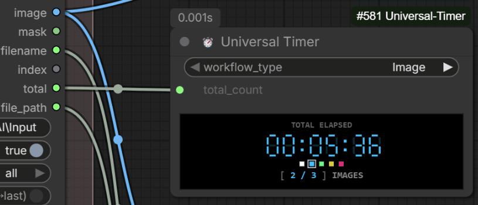

# 🎛️ ComfyUI Universal Timer
**Version: v0.2.0**

A universal execution timer for ComfyUI workflows that provides real-time duration tracking with dynamic unit mapping for any generation pipeline.

---

## 📌 Where to Find It in ComfyUI
After installation, you can find this node by right-clicking on the canvas, navigating to **utils/timer** (or using the search bar and typing **`Universal Timer`**).

---

## ✨ Features

* 🏭 **Mechanical-Style Industrial UI**: Sleek, retro-digital LED appearance featuring clean, intuitive status indicators for a geek-friendly aesthetic.
* 🔄 **Dynamic Unit Mapping**: Automatically adapts measurement units and counter labels based on your selected workflow type:
  * `Image` ➔ `IMAGES`
  * `Video` ➔ `FRAMES`
  * `Audio` ➔ `CLIPS`
  * `Prompt` ➔ `STEPS`
  * `Training` ➔ `EPOCHS`
  * `Custom` ➔ `ITEMS`
* 🎨 **Theme Persistence**: Click-to-change color palette (White, Blue, Green, Yellow, Pink). Your visual preferences automatically persist inside the **Workflow JSON** (per-workflow persistence).
* 📊 **Macro-Level Accurate Timing**: Unlike native node timers, this timer measures the **entire duration** of a workflow—from the first task starting to the very last task completing—without resetting between iterations.
* 🟢 **Dynamic Visual Status Feedback**: The progress counter `[ X / Y ] UNIT` (e.g., `[ 1 / 10 ] IMAGES`) changes color based on the workflow state:
  * ⚪ **Cool Gray (`[ READY ]`)**: Idle, waiting for execution.
  * 🔵 **Blue**: Workflow running.
  * 🟢 **Green (`[ Y / Y ]`)**: Workflow completed successfully.
  * 🟡 **Yellow (`[ INTERRUPT ]`)**: Workflow interrupted by the user.
  * 🔴 **Pink (`[ ERROR ]`)**: Workflow encountered an error and stopped.
* ⏸️ **Absolute Timer Independence**: Click the LED digits to pause/resume, or double-click to reset.
  > **⚠️ Semantic Note on Interaction:** Pausing **only freezes the UI time ticking**. It does *not* pause the backend workflow, nor does it stop the progress counter from updating. It is designed to let you exclude personal away-time from the final stats.
* 🛡️ **Multi-Workflow Isolation**: Open multiple workflows in the same browser session. The timer states are perfectly isolated per workflow to prevent cross-contamination.

---

<p align="center">
  <br>
  <sub>*Click LED digits to Pause/Resume, double-click to reset, and click swatches to change colors.*</sub>
</p>

---

## 📦 Installation

> **Note:** This node relies strictly on native web standard components and ComfyUI API events. No external Python dependencies or `requirements.txt` are required.

### Method 1: Via ComfyUI-Manager *(Recommended)*
1. Open ComfyUI and click on **Manager** in the menu.
2. Select **Custom Nodes Manager**.
3. Search for `ComfyUI-Universal-Timer`.
4. Click **Install** and restart your ComfyUI.

### Method 2: Manual Installation (Git Clone)
1. Navigate to your ComfyUI `custom_nodes` directory:
   ```bash
   cd ComfyUI/custom_nodes
   ```
2. Clone this repository:
   ```bash
   git clone https://github.com/hermankwan/ComfyUI-Universal-Timer
   ```
3. Restart your ComfyUI instance.

---

## 🎯 Conceptual Framework & Design Principles

To maintain absolute clarity and maintainability across complex pipelines, **Universal Timer** enforces strict architectural boundaries regarding workflow typing and batch execution.

### 1. The `workflow_type` Definition Rule (Output Asset Type Principle)
The classification of a workflow is governed strictly by its **Final Output Asset Type**, regardless of the intermediate processing steps, auxiliary models, control networks, or prompt enhancements involved:
* **`Image`**: Any pipeline whose terminal output is an image format.
* **`Video`**: Pipelines whose terminal delivery consists of video sequences or animation files.
* **`Audio`**: Pipelines terminating in sound or music synthesis.
* **`Prompt`**: Workflows dedicated to LLM-driven text prompt engineering or structured generation.
* **`Training`**: Workflows focused on model fine-tuning, embedding, or LoRA generation (`EPOCHS`).
* **`Custom`**: Any alternative or experimental output type falling outside the standard categories (`ITEMS`).

### 2. Total Count Principles: Tensor Batching vs. Sequential Loops
Universal Timer distinguishes between ComfyUI’s native tensor processing and iterative loop execution:
* **Native Tensor Batching (`batch_size = N` in KSampler / Latent)**:
  * **Behavior**: Processed in parallel during a *single* prompt execution cycle.
  * **Setting Rule**: Keep `total_count = 1`. The timer records the monolithic execution duration of the tensor bundle as 1 unit.
* **Sequential / Iterative Batching (e.g., Loop nodes, Batch Loaders)**:
  * **Behavior**: Processed iteratively across multiple execution rounds.
  * **Setting Rule**: Set `total_count = N` to track accurate real-time loop progress.

---

## 🚀 How to Use & Interactive Controls

1. Add **Universal Timer** to your ComfyUI workspace graph.
2. Select your pipeline category under **`workflow_type`** (the node instantly maps the corresponding unit label).
3. Set the total count in **`total_count`** (manually or via widget connection) for sequential loops, then click **Queue Prompt**.

### 🖱️ Canvas Interactions
* **Single Click (Pause/Resume)**: Click anywhere on the 7-segment LED time digits to freeze or continue the timer. (The cursor will change to a pointer).
* **Double Click (Reset)**: Double-click the LED digits to reset the clock back to `00:00:00`. 
  * If the workflow is currently running, the timer will restart from zero immediately.
  * If the workflow is idle, the clock will remain at `00:00:00`.
* **Theme Swatches**: Click any of the 5 color blocks below the digits to change the LED glow color instantly.

---

## 📋 Changelog

### v0.2.0 (Major Architecture Refactor)
* **Complete Codebase Rewrite**: Refactored into a modular ES Modules architecture (`timer_engine.js`, `progress_engine.js`, `ui_renderer.js`).
* **Batch Tracking Logic**: Rewrote the lifecycle monitoring logic to accurately track sequential loops and native batches without premature resetting.
* **Bulletproof Termination**: Added a robust "queue empty" fallback debounce, eliminating the issue where the timer would run indefinitely if a workflow was interrupted mid-batch.
* **State Isolation**: Timer interactions (Pause/Reset) are now fully decoupled from the progress counter. Added multi-workflow isolation.
* **UI/UX Overhaul**: 
  * Redesigned node layout and fixed window resizing conflicts.
  * Introduced dynamic color feedback for statuses (Ready/Running/Complete/Error/Interrupt).
  * Replaced the old hover-to-pause interaction with intuitive single-click/double-click controls.

### v0.1.0
* Initial release of **Universal Timer**.
* Introduced dynamic unit mapping across 6 core output categories.
* Added industrial ALL-CAPS status state machines.

---

## 📜 License

This project is licensed under the [MIT License](LICENSE).